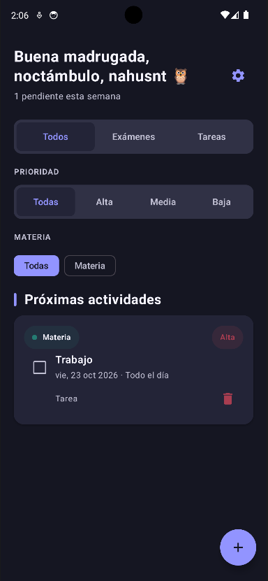
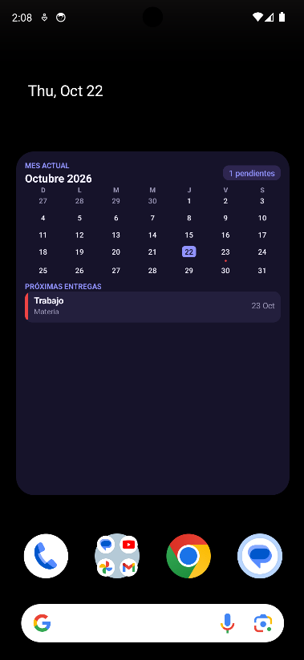
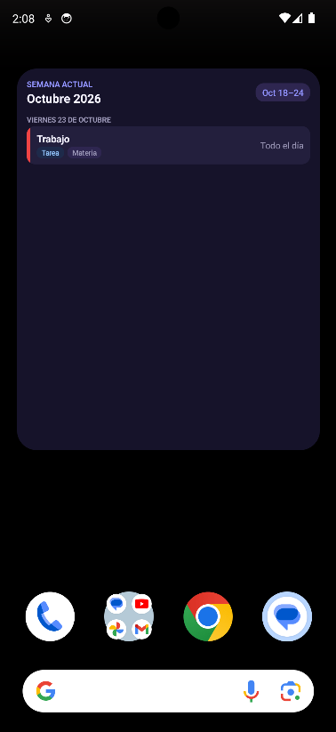
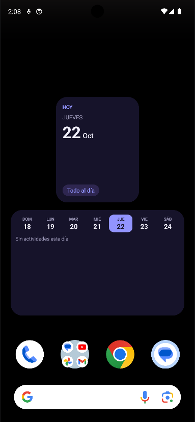

# 🌊 **Estudi (Android)**
### *Tu compañero académico inteligente*

---

## 📖 ¿Qué es Estudi?

**Estudi** es una aplicación moderna y minimalista para Android diseñada exclusivamente para estudiantes que desean organizar su vida académica de forma impecable. Olvídate del estrés: gestiona tus materias, entregas de tareas, exámenes y horarios con una interfaz fluida, personalizable y libre de distracciones.

---

## ✨ Características Principales (Versión 1.0.2)

* **✨ Rebranding Oficial a Estudi:** Nombre corto, moderno y memorable.
* **🌊 Nuevo Logo Minimalista:** Identidad visual renovada con diseño de ondas fluido sobre fondo limpio.
* **🕒 Horarios Flexibles:** Configura tus tareas y exámenes como *Hora específica* o *Todo el día*.
* **☑️ Subtareas con Checklists:** Desglosa tus proyectos en hasta 6 subtareas con completado automático al finalizar cada ítem.
* **⚡ Creación Rápida de Materias:** Añade y selecciona asignaturas al instante directamente desde el formulario de tareas.
* **🎨 Temas Visuales Avanzados:** Combina modos **Claro**, **Oscuro** o **Amoled** (negro puro) con paletas de color de acento independientes (*Violeta*, *Esmeralda*, *Azul Océano*, *Rosa*, *Menta*).
* **📱 Widgets en Tiempo Real:** Mantén tu día organizado con 4 widgets interactivos (Hoy, Semana, Lista semanal y Mensual).
* **🔒 Confirmación de Borrado:** Aviso de seguridad ante asignaturas con actividades asociadas.

---

## 📱 Capturas de Pantalla & Widgets

  <table style="border: none;">
    <tr>
      <td align="center">
        
<b>Pantalla Principal (Tema Amoled)</b>

        
      </td>
      <td align="center">
        
<b>Widget de Hoy</b>

        
      </td>
    </tr>
    <tr>
      <td align="center">
        
<b>Widget de Semana</b>

        
      </td>
      <td align="center">
        
<b>Widget Mensual con Entregas</b>

        
      </td>
    </tr>
  </table>

---

## 🌐 Ecosistema Estudi

* **[Estudi (Android)](https://github.com/nahusnt/estudi-app):** Aplicación nativa con Jetpack Compose y Widgets interactivos.
* **[Estudi Web](https://github.com/nahusnt/estudi-web):** Aplicación web ligera para organizar tareas personales con categorías y filtros.

---

## 🛠️ Tecnologías Utilizadas

* **Lenguaje:** 100% Kotlin
* **UI:** Jetpack Compose & Material 3
* **Arquitectura:** MVVM con StateFlow
* **Persistencia:** Almacenamiento local optimizado
* **Widgets:** Glance / AppWidgetProvider con actualización en tiempo real

---

## 📦 Descarga e Instalación

Puedes descargar el APK compilado de la última versión estable (`Estudi_Build_1.0.2.apk`) desde la sección de [Releases](https://github.com/nahusnt/estudi-app/releases) e instalarlo directamente en tu dispositivo Android.

---

## 🗺️ Roadmap

Consulta el [Roadmap Oficial](ROADMAP.md) para conocer las próximas funciones planificadas para las versiones 1.1.0 y superiores.

---

  Desarrollado con ❤️ por <b>Nahuel Thomas</b>

